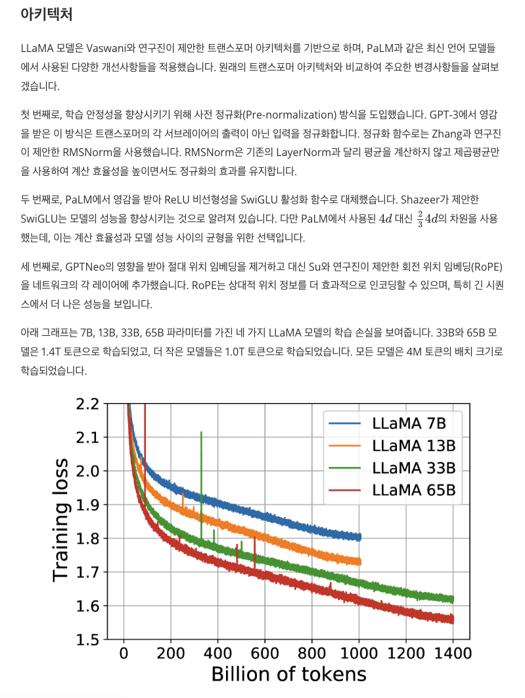
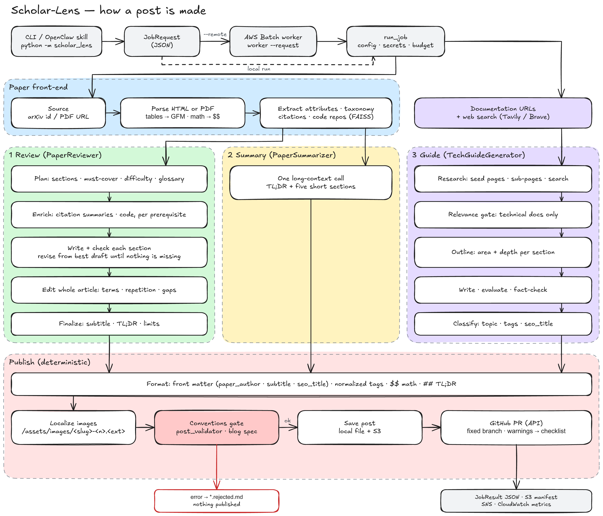
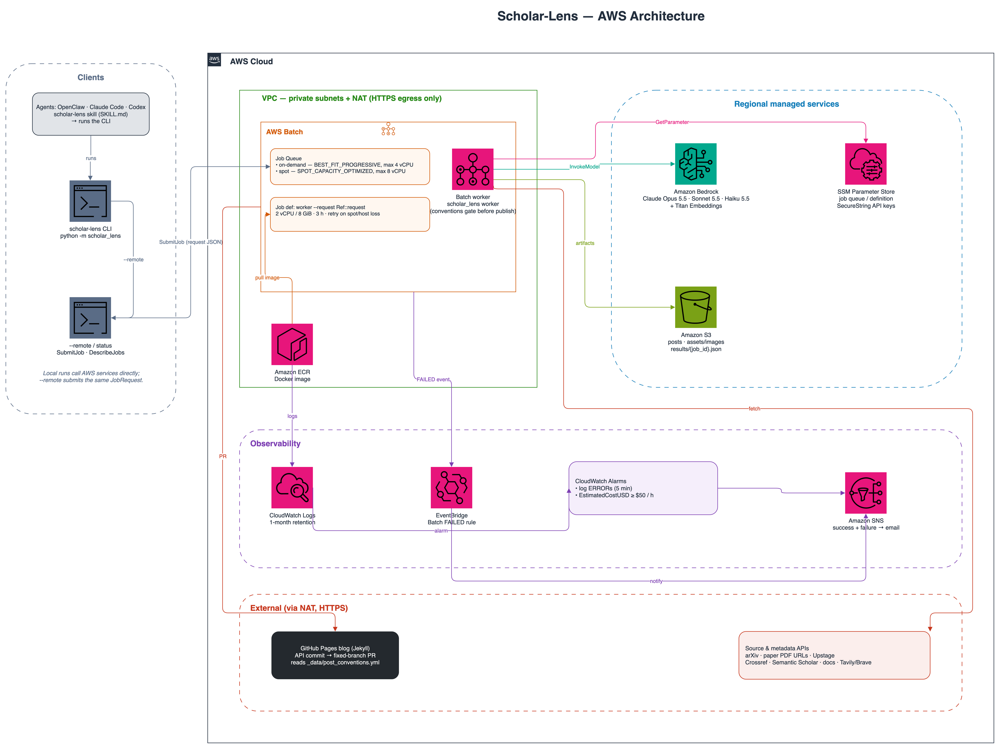

<div align="center">

# Scholar-Lens

**AI/ML 논문과 기술 문서를 블로그에 바로 올릴 수 있는 글로 바꿉니다. 심층 리뷰, 간결한 요약, 실습형 기술 가이드, 연구 주제의 논문 서베이를 만듭니다.**

로컬이나 AWS Batch에서 실행하며, 사람과 에이전트(OpenClaw, Claude Code, Codex)가 같은 CLI를 씁니다. Amazon Bedrock의 Claude로 동작합니다.

[](https://github.com/bits-bytes-nn/scholar-lens/actions/workflows/ci.yml)


-green)

[English README](./README.md) · [설계 문서](./docs/design.md)



</div>

## 하는 일

| 산출물 | 입력 | 출력 |
| --- | --- | --- |
| **리뷰** | arXiv ID 또는 논문 PDF URL, 선택 사항으로 코드 저장소 | 데이터 과학자와 ML 엔지니어를 위한 절별 리뷰. TL;DR, 수식 전의 직관, 풀이 예시, 그림, 한계 |
| **요약** | arXiv ID 또는 논문 PDF URL | TL;DR과 다섯 개의 짧은 절. 연구 배경, 제안 방법, 구현, 실험 결과, 의의와 한계 |
| **기술 가이드** | 문서 URL, 선택 사항으로 참고 자료 | 근거에 기반한 사용법, 내부 구조와 아키텍처, 더 큰 시스템에 통합하는 방법 |
| **논문 서베이** | 연구 주제, 이어서 편집한 계획 | `survey plan`: 주제의 주요 논문을 계보별로 정리한 편집 가능한 목록. `survey write`: 그림, 수식, 연표, 비교표를 갖춘 장문 서베이 |

모든 글은 블로그 규칙을 따르는 Jekyll Markdown이며, 저장 전에 검사합니다. 규칙을 어긴 글은 게시하지 않고 반려합니다. 글은 로컬 파일로 저장하고, 설정에 따라 S3에 올리고 블로그 저장소에 PR을 엽니다.

## 동작 방식



가이드와 서베이, 그리고 선택에 따라 리뷰와 요약은 하나의 근거 장부 엔진이 씁니다.

1. 읽기 에이전트가 출처마다 근거를 원문 그대로 인용해 기록하고, 코드가 이를 검사합니다.
2. 개요가 사실마다 하나의 절을 정해 글 종류의 순서에 배치합니다.
3. 절마다 근거로 초안을 쓰고 주장 단위로 검사합니다. 근거 없는 문장은 고치거나 지웁니다.
4. 글 전체를 검사하고(일관성, 반복, 포함 여부, 붙여 넣은 그대로 실행되는 코드), TL;DR, 마무리, 설명문을 씁니다.

리뷰와 요약은 sections 엔진(기본값)으로도 쓸 수 있습니다. 이 엔진은 논문의 포함 계획을 세우고 절마다 지침에 따라 쓰고 고칩니다. 게시 단계는 수식과 Markdown을 정리하고, 논문의 그림을 복사하고, 블로그 규칙 검사를 거쳐 글마다 정해진 브랜치에 PR을 엽니다.



단계와 규칙은 [docs/design.md](./docs/design.md), 엔진은 [docs/engine.md](./docs/engine.md)에 있습니다.

## 빠른 시작

준비물:

- Python 3.12 이상과 [Poetry](https://python-poetry.org/)
- 설정한 Claude 모델에 Bedrock 접근 권한이 있는 AWS 프로필
- PDF 파싱용 `UPSTAGE_API_KEY`
- 선택: `TAVILY_API_KEY` 또는 `BRAVE_API_KEY`(가이드 웹 조사), `GITHUB_TOKEN`(블로그 PR), `CROSSREF_MAILTO`, `OPENALEX_API_KEY`, `SEMANTIC_SCHOLAR_API_KEY`(인용 조회)

```bash
git clone https://github.com/bits-bytes-nn/scholar-lens.git && cd scholar-lens
poetry install --with dev
cp scholar_lens/configs/config-template.yaml scholar_lens/configs/config.yaml   # 편집
cp .env.template .env                                                           # 키 입력
poetry run python -m scholar_lens summarize 2106.09685 --no-pr
```

## 사용법

```bash
poetry run python -m scholar_lens review 2106.09685 --repo-url "https://github.com/microsoft/LoRA"
poetry run python -m scholar_lens summarize "https://openreview.net/pdf?id=nZeVKeeFYf9" --no-pr
poetry run python -m scholar_lens guide "https://docs.vllm.ai/en/latest/getting_started/quickstart.html" \
  --reference "https://arxiv.org/abs/2309.06180"
poetry run python -m scholar_lens survey plan "preference optimization for LLM alignment" --paper 2305.18290
poetry run python -m scholar_lens survey write --plan papers/survey-<slug>/plan.json
poetry run python -m scholar_lens review 2106.09685 --remote     # AWS Batch에서 실행
poetry run python -m scholar_lens status <job-id> --wait
poetry run python -m scholar_lens publish papers/<dir>/<post>.rejected.md   # 반려된 글을 고친 뒤
```

- 명령마다 결과 JSON 하나를 stdout에 출력하고, 로그는 stderr로 보냅니다.
- `--no-pr`는 PR 없이 글만 저장하고, `--remote`는 AWS Batch에 실행을 맡깁니다.
- 같은 입력으로 다시 실행하면 저장된 단계부터 이어서 진행합니다. `--fresh`는 모든 단계를 다시 계산합니다.
- URL은 따옴표로 감쌉니다. zsh에서는 따옴표 없는 `?`가 글롭으로 해석됩니다.

옵션 전체, 서베이 계획 형식, 재개와 재게시, 종료 코드, 설정 키는 [docs/usage.md](./docs/usage.md)(영문)에 있습니다.

에이전트(OpenClaw, Claude Code, Codex)는 `~/Projects/agent-config/skills/scholar-lens/SKILL.md` 스킬을 통해 같은 CLI를 호출합니다.

## 설정

`scholar_lens/configs/config.yaml`(Git 제외)은 엄격하게 검증하며, 템플릿에 모든 키와 기본값이 있습니다. 주로 정하는 항목은 다음과 같습니다.

- `resources`: AWS 프로필, Bedrock 리전, S3 버킷, 알림 이메일
- `resources.github`: 블로그 저장소, 브랜치 접두어, `author_email`(게시된 글을 같은 자리에 다시 생성할 때 필요)
- 산출물별 모델 ID, thinking 수준, 비용 상한(`max_cost_usd`)
- `explanation.engine`, `summary.engine`: `sections`(기본값) 또는 `evidence`
- `output_language`(기본값 `Korean`)

## AWS 배포

Node.js, Docker, AWS CDK CLI와 `resources.s3_bucket_name`에 지정한 기존 S3 버킷이 필요합니다.

```bash
cdk bootstrap --profile <profile_name>       # 계정·리전마다 한 번
cdk deploy --all --profile <profile_name>
poetry run python scripts/put_secrets.py     # .env 비밀값을 SSM에 저장
```

Batch 작업은 마지막 배포 때 이미지에 넣은 `config.yaml`을 씁니다. 설정을 바꾸면 다시 배포합니다. 추적, 경보, 스택은 [docs/usage.md](./docs/usage.md#deploy-to-aws)를 봅니다.

## 개발

```bash
poetry run pytest tests/          # AWS나 네트워크 없이 실행
poetry run ruff check scholar_lens scripts tests
poetry run black --check scholar_lens scripts tests
poetry run mypy scholar_lens scripts
poetry run lint-imports           # 계층 계약
```

CI는 이 검사에 더해 커버리지, pip-audit, CDK synth 검사, Docker 빌드를 실행합니다. 변경 내역은 [CHANGELOG.md](./CHANGELOG.md)에 있습니다.

## 라이선스

[LICENSE](./LICENSE)를 봅니다.
