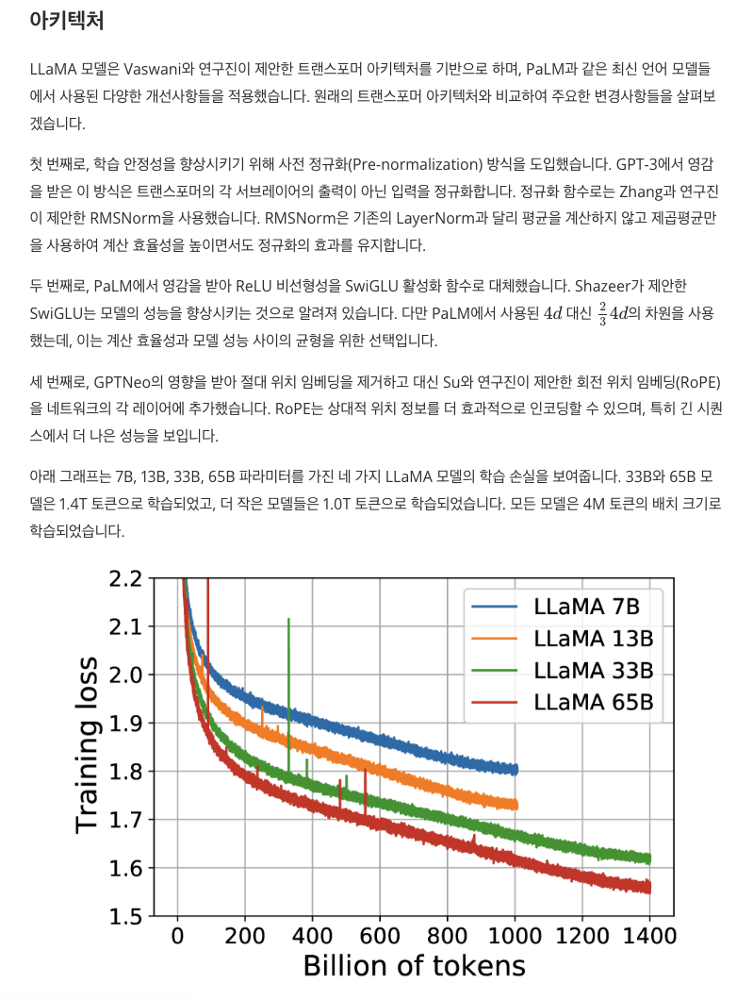
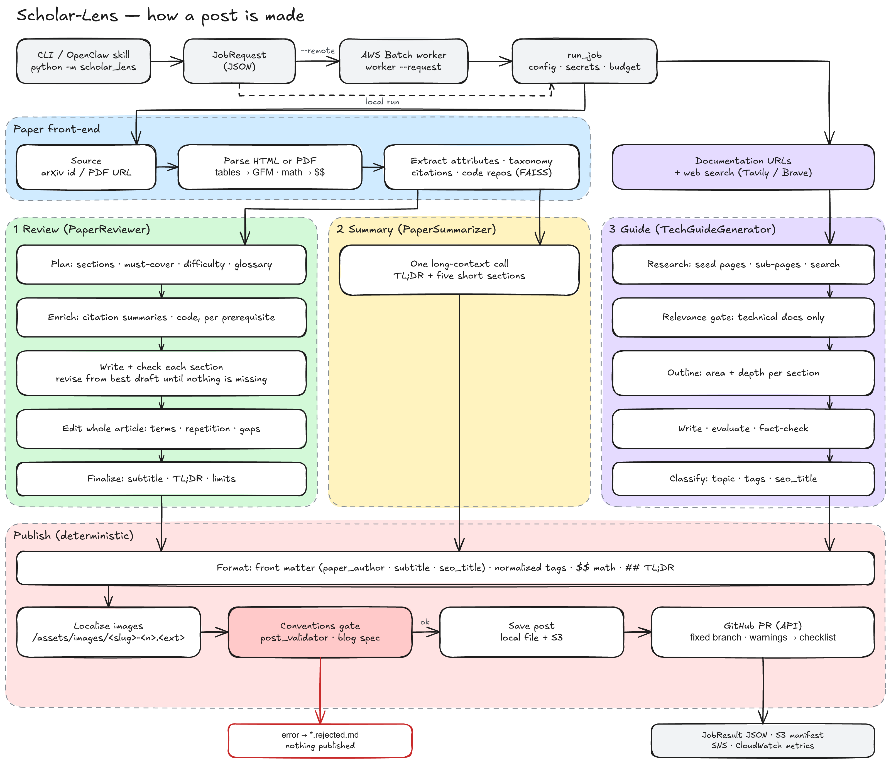
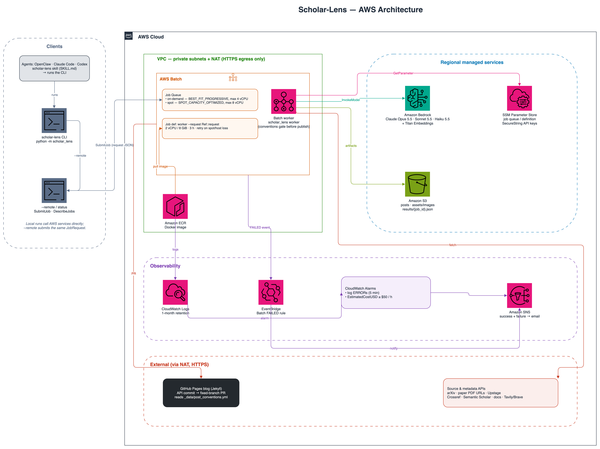

<div align="center">

# Scholar-Lens

**AI/ML 논문과 기술 문서를 블로그에 바로 올릴 수 있는 글로 바꿉니다. 심층 리뷰, 간결한 요약, 실습형 기술 가이드, 연구 주제의 논문 서베이를 만듭니다.**

로컬이나 AWS Batch에서 실행하며, 사람과 에이전트(OpenClaw, Claude Code, Codex)가 같은 CLI를 씁니다. Amazon Bedrock의 Claude로 동작합니다.

[](https://github.com/bits-bytes-nn/scholar-lens/actions/workflows/ci.yml)


-green)

[English README](./README.md) · [설계 문서](./docs/design.md)



</div>

## 하는 일

| 산출물 | 입력 | 출력 |
| --- | --- | --- |
| **리뷰** | arXiv ID 또는 논문 PDF URL(코드 저장소 선택) | 일반 DS/MLE 독자를 위한 절별 리뷰입니다. 쉬운 내용은 짧게, 어려운 내용은 직관 → 수식 → 작은 예제 순으로 쌓아 올리며 그림, 표, TL;DR, 한계와 시사점을 포함합니다 |
| **요약** | arXiv ID 또는 논문 PDF URL | TL;DR과 다섯 개의 짧은 절(동기, 아이디어, 구현, 결과, 의의와 한계) |
| **기술 가이드** | 문서 URL, 참고 자료(논문, 설계 문서, 심층 분석 글) 또는 둘 다 | 설치와 사용법, 내부 동작 방식과 설계 이유, 주요 기능의 의미, 더 큰 시스템에 통합하는 방법을 다루는 출처 기반 가이드. 하위 페이지와 웹 검색으로 조사합니다 |
| **논문 서베이** | 연구 주제(필수 논문, 참고 자료, 연도 범위 선택), 이어서 계획 파일 | `survey plan`: 고칠 수 있는 JSON 계획 파일. OpenAlex와 arXiv에서 찾은 주제의 주요 논문을 시간순 계보로 묶고 역할, 선정 이유, 인용 관계를 적습니다. `survey write`: Lilian Weng의 블로그 같은 긴 글. 계보별 논문을 설명하고 서로 잇고, 논문의 그림과 핵심 수식, 연표와 비교표, 통찰, 저자-연도 인용을 담습니다 |

모든 글은 대상 블로그의 규칙을 따르는 Jekyll Markdown이며, 저장하기 전에 검사합니다. 규칙을 어긴 글은 게시하지 않고 거부합니다. 글은 로컬 파일로 저장되고, 설정에 따라 S3에 올라가며 블로그 저장소에 PR로 제안됩니다.

## 동작 방식



- **리뷰**: 계획 단계가 논문 전체를 읽고 집필 계획을 만듭니다. 계획에는 절 구성, 반드시 다룰 항목, 난이도, 선수 개념, 개념별 담당 절, 그림 배정, 용어집이 들어갑니다. 각 절은 지시서대로 쓴 뒤 지시서에 비추어 검수하고, 빠진 항목이 없을 때까지 고칩니다. 마지막으로 글 전체를 한 번 편집해 용어, 중복, 누락을 바로잡습니다.
- **요약**: 파싱한 논문 전체를 입력으로 한 번 호출합니다.
- **가이드**: 조사(문서, 참고 자료, 그리고 사용법·내부 구조와 설계·운영 통합을 찾는 웹 검색) → 관련성 판정 → 개요 → 절별 작성·평가·사실 확인 순서입니다. 명령, 플래그, 기본값은 공식 문서가 정하고, 개념·내부 구조·아키텍처는 논문, 설계 문서, 신뢰할 수 있는 기술 글도 근거로 씁니다.
- **서베이 계획**: 사용자가 준 참고 자료(블로그 글, 서베이 글, 논문 페이지)를 한 번 읽습니다. 범위 호출이 주제와 그 발췌를 보고 계보, 검색어, 주요 논문 제목을 제안하면 OpenAlex와 arXiv 검색(arXiv 메타데이터는 DataCite로 확인, 키가 있으면 Semantic Scholar 인용 수)으로 후보를 모으고, 참고 자료 자신이나 거기서 링크한 논문(arXiv·doi.org 링크, `arXiv:` ID)도 후보에 더한 뒤 코드가 병합·연결·순위를 정합니다. 선정 호출이 설정 범위 안에서 논문을 고르면 코드가 검증한 뒤 계획을 저장합니다.
- **서베이 쓰기**: 고친 계획을 다시 검증하고 손으로 더한 논문은 DataCite·OpenAlex로 채웁니다. 논문마다 카드를 만들어 캐시합니다(핵심 논문은 arXiv HTML 전문, 보조 논문은 초록으로 한 번 호출). 카드의 숫자·수식·그림은 코드가 논문과 대조합니다. 개요 호출이 절(도입, 계보별 절, 필요하면 계보를 가로지르는 절, 비교, 통찰)을 정하면 코드가 논문 수로 절 길이를 정하고, 각 절은 가이드처럼 쓰기·평가·한 번 수정·카드 기준 사실 확인을 거칩니다. 분야를 짜는 절(도입, 계보를 가로지르는 절, 비교, 통찰)은 계획의 참고 자료 글 발췌도 설명 자료로 받습니다(논문 사실의 근거로는 쓰지 않고, 견해는 그 글의 이름으로 밝힘). 코드가 `[@id]` 인용 키를 저자-연도 링크로 바꾸고 연표, 비교표, 참고 문헌, 참고 자료 글 목록을 만듭니다.
- **발행**: 수식과 Markdown 정규화, 논문 자신의 그림을 블로그로 복사(그 밖의 이미지는 원본 링크로 둠), 블로그 규칙 검사를 거친 뒤 S3에 올리고, 글마다 고정된 브랜치로 GitHub PR을 엽니다.



단계별 동작, 규칙, 설정 키는 [docs/design.md](./docs/design.md)에 있습니다.

## 빠른 시작

사전 조건:

- Python 3.12 이상과 [Poetry](https://python-poetry.org/)
- `bedrock_region_name` 리전에서 설정한 모델(기본값: Claude Opus 5.5, Sonnet 5.5, Haiku 5.5)에 접근할 수 있는 AWS 프로필
- PDF 파싱용 `UPSTAGE_API_KEY`(arXiv가 아닌 소스와 HTML 대체 경로에 필요)
- 선택: 가이드 웹 조사용 `TAVILY_API_KEY` 또는 `BRAVE_API_KEY`, 블로그 PR용 `GITHUB_TOKEN`, 인용 조회 한도를 높이는 `CROSSREF_MAILTO`(Crossref·OpenAlex polite pool), `OPENALEX_API_KEY`(키 없이 IP당 하루 약 100회인 OpenAlex 검색 한도를 높임)와 `SEMANTIC_SCHOLAR_API_KEY`(키가 있을 때만 Semantic Scholar 조회)

```bash
git clone https://github.com/bits-bytes-nn/scholar-lens.git && cd scholar-lens
poetry install --with dev
cp scholar_lens/configs/config-template.yaml scholar_lens/configs/config.yaml   # 편집
cp .env.template .env                                                           # 키 입력
poetry run python -m scholar_lens summarize 2106.09685 --no-pr
```

## 설정

`scholar_lens/configs/config.yaml`(Git 제외)은 엄격하게 검증하며, 모르는 키가 있으면 오류입니다. 템플릿에 모든 키와 기본값이 있습니다. 파일이 없으면 로컬 실행은 이 기본값(S3 버킷 없음, GitHub 연동 꺼짐)과 기본 AWS 자격 증명으로 동작하므로, Bedrock을 호출하고 비용이 듭니다. 주로 바꾸는 값은 다음과 같습니다.

- `resources`: `profile_name`, `bedrock_region_name`, `s3_bucket_name`(`cdk deploy`와 Batch 실행에 필요. 없으면 `status`는 저장된 결과 없이 Batch 상태만 보여 줌), `email_address`(SNS 알림)
- `resources.github`: `enabled`, `repo_name`(예: `owner/owner.github.io`), `base_branch`, `branch_prefix`, 산출물 유형별 카테고리 이름
- 단계별 `*_model_id`, `thinking_effort`, 품질 기준, `max_total_tokens` 비용 상한(기본값: 리뷰 800만, 요약 100만, 가이드 300만, 서베이 계획 30만, 서베이 쓰기 450만 토큰(`survey.write_max_total_tokens`))
- `survey`: `min_papers`·`max_papers`(6·25), `candidate_pool`(60), 쓰기 단계의 `chars_per_core_paper`·`chars_per_supporting_paper`(3,000·800), `min_total_chars`·`max_total_chars`(20,000·70,000), `card_source_chars`
- `resources.github.survey_category`(`Paper Surveys`): 블로그 글 규칙에 있는 유형이어야 하며, 없으면 `survey write`가 모델을 부르기 전에 멈춥니다
- `output_language`(기본값 `Korean`)

## CLI

```bash
poetry run python -m scholar_lens review 2106.09685 --repo-url "https://github.com/microsoft/LoRA"
poetry run python -m scholar_lens summarize "https://openreview.net/pdf?id=nZeVKeeFYf9" --no-pr
poetry run python -m scholar_lens guide "https://docs.vllm.ai/en/latest/getting_started/quickstart.html" \
  "https://docs.vllm.ai/en/latest/serving/openai_compatible_server.html" \
  --reference "https://arxiv.org/abs/2309.06180" \
  --reference "https://blog.vllm.ai/2025/01/27/v1-alpha-release.html"
poetry run python -m scholar_lens survey plan "preference optimization for LLM alignment" \
  --paper 2305.18290 --since 2017 \
  --reference "https://huggingface.co/blog/rlhf" \
  --reference "https://arxiv.org/abs/2312.14925"                # papers/survey-<slug>/plan.json 저장
poetry run python -m scholar_lens survey write \
  --plan papers/survey-preference-optimization-for-llm-alignment/plan.json --no-pr
poetry run python -m scholar_lens review 2106.09685 --remote     # AWS Batch에 제출
poetry run python -m scholar_lens status <job-id> --wait         # 원격 작업 조회
```

| 옵션 | 명령 | 효과 |
| --- | --- | --- |
| `--repo-url URL` | review, summarize | 논문 코드에 근거해 서술합니다(반복 가능) |
| `--parse-pdf` | review, summarize | arXiv HTML이 있어도 PDF를 파싱합니다 |
| `--reference URL` | guide | 바탕으로 삼을 참고 자료(논문, 설계 문서, 심층 분석 글, 발표 페이지)입니다. HTML 페이지나 arXiv 링크여야 하며 그 밖의 PDF는 읽지 않습니다. 반복 가능하고, 위치 인자인 문서 URL(0개 이상)의 앞뒤 어디에나 둘 수 있습니다. 두 쪽에 모두 준 URL은 문서로 다루며 한 번만 나열합니다. 항상 쓰고 출처 목록에 넣지만 공식 문서로 다루지 않습니다 |
| `--search-query Q` | guide | 웹 검색어를 지정합니다(반복 가능, 자동으로 계획한 검색어를 대신함) |
| `--no-subpages` | guide | 하위 페이지를 따라가지 않습니다 |
| `--paper ID_OR_URL` | survey plan | 서베이에 꼭 넣을 논문입니다. arXiv ID나 URL, 또는 DOI(반복 가능) |
| `--reference URL` | survey plan | 참고할 자료입니다(반복 가능). 블로그 글, 서베이·리뷰 글, 논문 페이지를 HTML 페이지나 arXiv 링크로 줍니다. 한 번 읽어 발췌로 범위를 잡고, 자료 자신이거나 자료가 링크한 논문(arXiv abs·pdf·html, doi.org 링크, 본문의 `arXiv:<id>`)을 후보에 더합니다. 이 후보는 `[REFERENCED by N]`으로 표시하고, 그 논문을 가리킨 자료 수는 주제 근거(풀 안의 피인용 수와 검색어 적중)가 같은 후보 사이의 순서를 정하며, 필수 논문은 아닙니다. 읽지 못한 자료는 실패가 아니라 계획 메모로 남습니다. 계획은 자료를 `references[]`로 저장하고, `survey write`가 그중 글(article)을 다시 읽어 도입·가로지르는 절·비교·통찰 절에 주고 `### 참고 자료`(영어 출력은 `### Further reading`)로 나열합니다 |
| `--since YEAR`, `--until YEAR` | survey plan | 이 연도의 논문만 다룹니다(필수 논문은 예외) |
| `--plan PATH_OR_S3_URI` | survey write | 계획 파일입니다. 로컬 경로 또는 설정한 버킷의 `s3://<bucket>/<key>`이며, `--remote`이면 로컬 계획을 먼저 `<s3_prefix>/surveys/<slug>/plan-<sha256>.json`에 올립니다 |
| `--no-pr` | review, summarize, guide, survey write | 글은 저장(·업로드)하되 PR은 열지 않습니다 |
| `--remote` | review, summarize, guide, survey plan, survey write | AWS Batch에 제출하고 작업 ID를 돌려줍니다 |
| `--wait`, `--timeout S` | status | 작업이 끝나거나 `S`초가 지날 때까지 조회합니다 |

`survey plan`은 글을 쓰지 않습니다. `JobResult`의 `plan_path`(로컬 `papers/survey-<slug>/plan.json`. `--remote` 실행은 컨테이너가 사라지므로 비어 있음)와 `s3_uri`(S3 사본. 원격 실행 뒤에는 이 값을 `survey write --plan`에 넘김)가 계획 파일입니다. 계획을 고친 뒤(논문 빼기·더하기·옮기기, 역할 바꾸기, 계보 이름 바꾸기) `survey write --plan`에 넘깁니다. 계획 단계를 다시 실행하면 내용이 다른 기존 계획은 `plan.<UTC 시각>.json`으로 남습니다. 손으로 더하는 논문은 `id`(arXiv ID나 URL, 또는 DOI), `lineage`, `role`만 있으면 되고, 제목·저자·연도·URL은 쓰기 단계가 채웁니다. 손으로 더하는 참고 자료는 `url`만 있으면 되고 `kind`는 URL로 정합니다(arXiv·doi.org 링크는 `paper`, 나머지는 `article`). 쓰기 단계는 `article`만 읽습니다. 계획에는 `core` 논문이 하나 이상 있어야 합니다. 논문 카드는 논문, 카드 스키마, 모델, 언어와 카드 프롬프트·`card_source_chars`의 `-<variant>` 요약값별로 캐시하므로(둘 중 하나가 바뀌면 카드를 다시 만듦)(로컬 `papers/survey-cards/`, S3 `<s3_prefix>/surveys/cards/`) 다시 실행하거나 같은 논문을 다루는 다른 서베이가 재사용합니다. 계획 필드와 쓰기 단계는 [설계 문서](./docs/design.md#43-논문-서베이)에 있습니다.

모든 명령은 stdout에 JSON 객체 하나(실행은 `JobResult`, `--remote`는 `job_id`, `status`는 Batch 상태와 저장된 결과)를 출력하고, 로그는 stderr로 보냅니다. 종료 코드는 `0` 성공 또는 제출, `1` 실패, `2` 입력 거부, `3` 진행 중, `4` 명령 자체의 실패입니다([상세](./docs/design.md#21-명령)). URL은 따옴표로 감쌉니다. zsh에서는 따옴표 없는 URL의 `?`가 glob으로 해석되어 명령이 실패합니다.

## 에이전트에서 쓰기(OpenClaw, Claude Code, Codex)

에이전트도 같은 CLI를 씁니다. `~/.openclaw/workspace/skills/scholar-lens/SKILL.md` 스킬이 호출 방법, `--remote`를 쓸 때, 사용자가 게시를 요청하지 않으면 `--no-pr`이 기본이라는 점을 안내합니다. MCP 서버 대신 CLI와 스킬을 택한 이유는 실행이 수 분에서 한 시간까지 걸리기 때문입니다. `--remote`와 `status`로 이미 비동기 계약이 있고, 스킬 디렉터리는 Claude Code와 Codex에도 공유됩니다.

## 블로그 규칙 검사

글을 저장하기 전에 블로그의 `_data/post_conventions.yml`(사본 `assets/post_conventions.yml`) 규칙으로 검사합니다. error가 있으면 게시를 멈추고 글을 `*.rejected.md`로 남기며, warning은 PR 체크리스트가 됩니다([규칙](./docs/design.md#6-블로그-규칙과-검증)).

## AWS 배포

위 조건에 더해 Node.js, Docker, AWS CDK CLI와 `resources.s3_bucket_name`에 적은 기존 S3 버킷이 필요합니다(스택은 버킷을 만들지 않습니다. 작업 역할이 버킷 전체 목록을 볼 수 있으므로 Scholar Lens 전용 버킷을 씁니다). `resources.profile_name`과 같은 프로필을 넘깁니다.

```bash
cdk bootstrap --profile <profile_name>           # 계정·리전당 한 번
cdk deploy --profile <profile_name>              # cdk.json: poetry run python scripts/deploy_infra.py
poetry run python scripts/put_secrets.py         # .env의 비밀값을 SSM SecureString에 기록
poetry run python scripts/put_secrets.py github-token   # 비밀값 하나를 교체한 뒤
```

Batch 작업은 마지막 배포 때 이미지에 넣은 `config.yaml`을 쓰므로, 설정을 고치면 `cdk deploy`를 다시 실행합니다([스택 상세](./docs/design.md#10-인프라)).

스택의 1시간 비용 경보는 Batch 실행만 다룹니다. 로컬 실행은 CloudWatch 지표를 보내지 않으므로 출력된 결과의 `estimated_cost_usd`로 비용을 확인합니다([경보](./docs/design.md#11-관측성)).

## 개발

```bash
poetry run pytest tests/ -W ignore::DeprecationWarning --cov=scholar_lens --cov=scripts --cov-fail-under=85   # CI와 같은 명령, AWS·네트워크 없음
poetry run ruff check scholar_lens scripts tests
poetry run black --check scholar_lens scripts tests
poetry run mypy scholar_lens scripts
poetry run python scripts/ci_synth_check.py      # 가짜 계정으로 CDK synth
actionlint                                       # GitHub 워크플로 검사
```

## 변경 이력

- `survey plan --reference URL`(반복 가능, survey_plan 요청의 `reference_urls`)을 다시 넣었고 이제 실제로 씁니다. 계획 단계가 자료마다 한 번 읽어 범위 호출에 발췌를 주고, 자료 자신이거나 자료가 링크한 논문을 후보에 더합니다(순위에서는 주제 근거 다음의 동점 처리 기준이 되고 후보 목록에 `[REFERENCED by N]` 표시). 계획은 자료를 `references[]`로 저장하고(`schema_version` 3, 버전 1·2 계획도 읽음), 쓰기 단계는 참고 자료 글을 분야를 짜는 절의 설명 자료로 쓰고 `### References` 뒤에 참고 자료 목록으로 붙입니다. `--remote`로 쓰려면 다시 배포합니다.

- `survey write --plan <파일>`(kind `survey_write`)을 추가했습니다. 고친 계획으로 `Paper Surveys` 글을 씁니다. 캐시하는 논문 카드, 개요, 가이드식 절별 집필과 검사, 코드가 만드는 연표와 비교표, 논문 그림, 저자-연도 인용이 들어갑니다. 블로그 글 규칙에 `Paper Surveys` 유형(`resources.github.survey_category`)이 있어야 합니다. 블로그가 이 유형을 `main`에 반영하기 전에는 함께 배포하는 `assets/post_conventions.yml`을 바꾸지 않으며(사본 차이 검사가 실패함), 테스트는 그 유형을 더한 규칙을 씁니다. 가이드의 평가·수정 반복과 사실 확인 재시도를 공용 함수(`tech_guide.revise_section`, `checked_grounding`)로 옮겼고 동작은 같습니다. `--remote`로 쓰려면 다시 배포합니다.
- `survey plan "<주제>"`(kind `survey_plan`)를 추가했습니다. 주제의 주요 논문을 찾아 고칠 수 있는 계획 파일로 저장합니다(`plan_path`, `s3_uri`). `SEMANTIC_SCHOLAR_API_KEY`가 없으면 인용 수는 OpenAlex 값이라 arXiv 시대 ML 논문을 적게 세고, 알려진 인용 관계도 적습니다. `--remote`로 쓰려면 다시 배포합니다.
- 업그레이드한 뒤 `--remote`를 쓰기 전에 `cdk deploy`로 다시 배포합니다. Batch 이미지는 마지막 배포의 코드를 실행하며, 이전 worker는 모르는 필드(예: `--reference`)가 든 요청을 거부합니다.
- 가이드가 더 깊고 넓어졌습니다. 사용법, 내부 동작 원리와 이유, 더 큰 시스템에 통합하는 방법까지 다룹니다. 개요 단계의 절 계획이 개념마다 담당 절을 하나씩 정하고, 평가자가 지적한 차단 문제(사실 오류, 모순, 근거 없는 플래그·기본값)가 있으면 반드시 고쳐 쓰며, `tech_guide.max_revision_attempts` 기본값은 1회입니다. 실행 비용은 이전보다 늘었습니다.
- `guide --reference URL`(반복 가능)로 문서 URL 옆에 참고 자료(논문, 설계 문서, 심층 분석 글)를 더할 수 있고, 참고 자료만으로도 가이드를 만들 수 있습니다. 문서 URL은 옵션 앞뒤 어디에나 둘 수 있습니다.
- 가이드 기본값이 바뀌었습니다. `tech_guide.fetch_top_results`는 12(이전 4)이고, `tech_guide.max_sections`가 개요의 절 수 상한입니다. 이전 템플릿에서 복사한 `config.yaml`은 예전 값을 그대로 유지하므로, 새 기본값을 쓰려면 직접 고칩니다.
- 논문 글은 front matter에 `paper_doi`를 넣습니다(arXiv 논문은 arXiv DOI, 그 밖에는 논문 DOI를 알 때). 블로그는 이 값으로 Semantic Scholar에서 인용 수를 조회합니다.
- 인용 조회: Crossref 다음에 OpenAlex를 조회합니다(키 없이 IP당 하루 약 100회 검색, 선택 키 `OPENALEX_API_KEY`로 한도를 높임). Crossref는 상위 5건 중 제목이 일치하는 레코드를 고르며, Semantic Scholar는 `SEMANTIC_SCHOLAR_API_KEY`가 있을 때만 조회합니다.
- `citations.citation_analysis_model_id`를 없앴습니다. 기존 `config.yaml`에서 지우지 않으면 설정을 불러올 때 `extra_forbidden` 오류가 납니다.
- 블로그로 복사하는 이미지는 논문 자신의 그림(arXiv HTML 그림, arXiv 원본에서 되살린 그림, PDF에서 잘라낸 그림)뿐입니다. 문서 사이트, 블로그, 참고 자료 같은 그 밖의 이미지는 원본 링크로 두고 PR 체크리스트에 `remote image not localized`로 올립니다. 논문 그림을 저장하지 못하면 글을 게시하지 않으며, 실행 결과의 `markdown_path`와 `s3_uri`가 거부된 초안을 가리킵니다.
- ar5iv는 쓰지 않습니다. ar5iv 링크는 검증 오류이고, arXiv 그림이 ar5iv의 "NO IMAGE AVAILABLE" 자리표시 이미지로 오면 논문의 arXiv 원본(`/e-print`)에서 그림을 가져옵니다.
- `glightbox` 링크는 자기 이미지를 열어야 합니다(`href`가 안쪽 `src`와 같음). 다르면 글을 거부합니다.
- 논문 글에 생성한 `description`을 넣습니다. 모델·방법 이름으로 시작하는 120–160자 평문이며 블로그 안에서 겹치지 않아야 합니다. 설명의 수치는 TL;DR·초록과, TL;DR의 수치는 논문과 대조합니다. 맞지 않으면 리뷰의 보정 재시도에 반영하거나 PR 메모로 남기며, 글을 막는 것은 블로그 안에서 겹치는 설명뿐입니다. 단위가 붙은 수와 한국어 복합 수는 양으로 비교하고(`12만 8천`은 `128K`와 같음), "~만"(only)으로 쓴 `만`(`5만 사용`, `10만큼`)은 단위로 읽지 않습니다.
- 이미 게시된 글을 다시 생성하면, 생성 이후 그 글이나 이미지에 사람이 고친 커밋을 PR에 나열해 옮겨 적용할 수 있게 합니다.
- 참고 목록과 출처 목록은 URL마다 한 줄인 `[제목](URL)` 형식이며, 가이드 출처는 수집한 페이지 제목을 씁니다.
- 가이드 절 분량은 산문만 셉니다. 코드, 표 행과 이미지는 빼고 셉니다.
- 모든 프롬프트가 하나의 용어 규칙을 씁니다. 번역 지침에 있는 용어는 지침의 표기를 따르고(이제 가이드도 번역 지침을 받음), 그 밖의 용어는 자연스러운 번역이 있으면 번역해 처음 쓸 때 영어를 괄호로 덧붙입니다. 영어 단어에 붙인 하다·되다 활용형(`prefill하면서`, `swap-in되어`)은 lint가 찾습니다.

## 라이선스

[LICENSE](./LICENSE)를 참고하세요.
