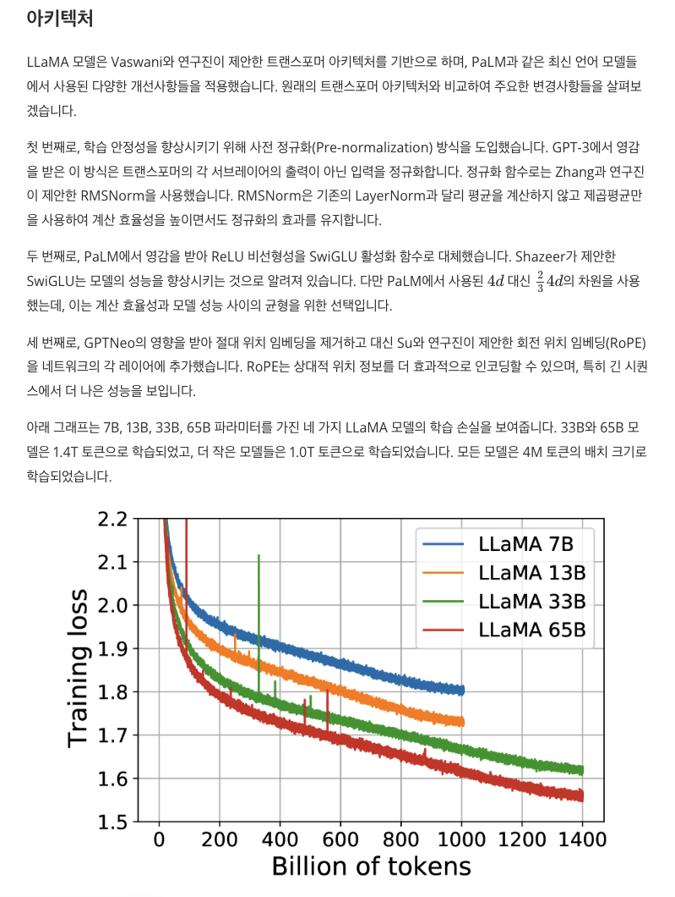
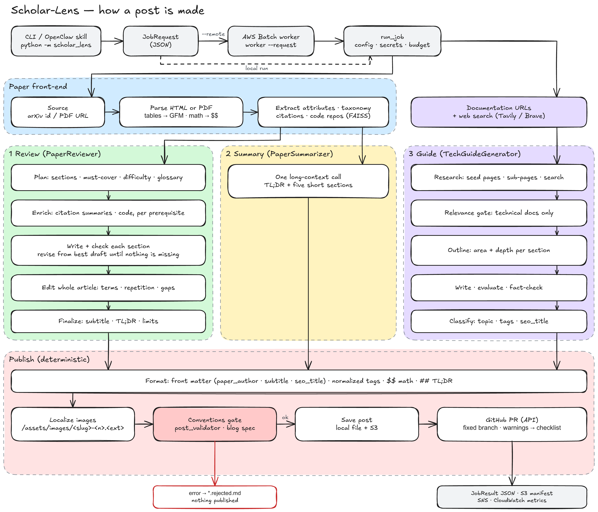
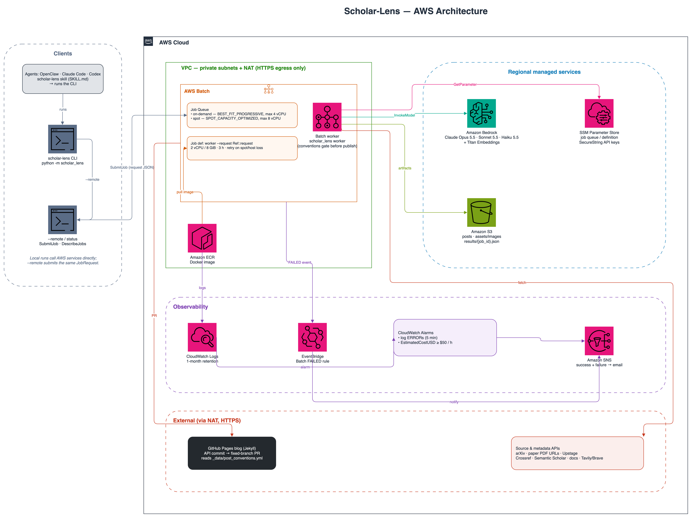

<div align="center">

# Scholar-Lens

**Turn AI/ML papers and documentation into blog-ready posts: in-depth reviews, concise summaries, hands-on technical guides, and surveys of a research topic's papers.**

Runs locally or on AWS Batch, driven by a CLI that people and agents (OpenClaw, Claude Code, Codex) share. Powered by Claude on Amazon Bedrock.

[](https://github.com/bits-bytes-nn/scholar-lens/actions/workflows/ci.yml)


-green)

[한국어 README](./README.ko.md) · [Design reference](./docs/design.md)



</div>

## What it does

| Artifact | Input | Output |
| --- | --- | --- |
| **Review** | arXiv id or paper PDF URL (+ optional code repos) | Section-by-section review for a general DS/MLE reader: easy parts short, hard parts built up from intuition to math to a worked example, with figures, tables, a TL;DR and a limitations section |
| **Summary** | arXiv id or paper PDF URL | A TL;DR plus five short sections (research background, proposed method, implementation, experimental results, significance and limits) |
| **Tech guide** | Documentation URLs and/or reference material (papers, design docs, deep-dive posts) | A source-grounded guide covering installation and usage, how the internals work and why, what each major feature means, and how to fit the tool into a larger system; researched across sub-pages and web search |
| **Paper survey** | A research topic (+ optional required papers, reference material to consult and years), then the plan file | `survey plan`: an editable JSON plan of the topic's major papers (OpenAlex, arXiv) in chronological lineages with roles, reasons and citation links. `survey write`: a long-form post in the style of Lilian Weng's blog: each lineage's papers explained and connected, with the papers' figures and key equations, a timeline and a comparison table, insights and author-year citations |

Every post is Jekyll Markdown that follows the target blog's conventions, and is checked before it is saved: a post that breaks a rule is rejected instead of published. Posts go to a local file, optionally S3, and optionally a pull request on the blog repository.

## How it works



- **Review:** a planner reads the whole paper and writes a coverage plan (sections, must-cover items, difficulty, prerequisites, concept ownership, figures, glossary). Each section is written from its brief, checked against it, and revised until nothing is missing; one editing pass then fixes terminology, repetition and gaps across the article.
- **Summary:** one long-context call over the parsed paper.
- **Review or summary on the evidence engine** (`explanation.engine` / `summary.engine: evidence`; the default is `sections`, above): reading agents record checked evidence from groups of the paper's sections, an outline gives each fact to one section in the post's fixed order, and each section is drafted from its evidence and checked claim by claim, as for guides and surveys.
- **Guide:** research (the docs, the reference material, and web searches for usage, internals and design, and production integration) → relevance gate → official reference pages for flags only third-party pages show → the evidence engine: a reading agent per page records evidence that code checks against the page and its authority, an outline gives each fact to one section in the guide's order (TL;DR, the problem, concepts and architecture before usage and operations, when to choose it), and each section is drafted from its evidence and checked claim by claim. Official docs decide commands, flags and defaults; papers, design docs and reputable write-ups may ground concepts, internals and architecture.
- **Survey plan:** the user's reference material (blog posts, survey articles, paper pages) is read once; a scope call proposes lineages, search queries and landmark titles from the topic and excerpts of that material; OpenAlex and arXiv searches (arXiv's metadata checked via DataCite, Semantic Scholar counts with a key) build a candidate pool, joined by the papers the references are or link to (arXiv and doi.org links, `arXiv:` ids), that code merges, links and ranks; a selection call picks the papers within the configured bounds, and code validates the choice before the plan is saved.
- **Survey write:** the (edited) plan is validated again and hand-added papers are completed from DataCite/OpenAlex; a reading agent per paper (arXiv HTML, else the PDF, else the abstract) records evidence with the paper's verbatim words, checked in code; an outline gives each fact to one section (introduction, one per lineage, optional cross-cutting ones, comparison, insights) whose lengths code derives from the paper counts; each section is drafted from its evidence and checked number by number and claim by claim, and sentences their evidence does not support are cut; the introduction, cross-cutting and insights sections also get excerpts of the plan's reference articles as explanatory material; code builds the timeline and comparison table, renders citations as author-year links and adds the reference list and a further-reading list of the reference articles.
- **Publishing:** math and Markdown normalization, copying the paper's own figures into the blog (any other image stays a link to its source), the blog-conventions gate, then S3 and a GitHub PR on a fixed branch per post.



See [docs/design.md](./docs/design.md) for every stage, rule and configuration key.

## Quick start

Prerequisites:

- Python 3.12+ and [Poetry](https://python-poetry.org/)
- An AWS profile with Bedrock access to the configured models in `bedrock_region_name` (defaults: Claude Opus 5.5, Sonnet 5.5, Haiku 5.5)
- `UPSTAGE_API_KEY` for PDF parsing (non-arXiv sources and the HTML fallback)
- Optional: `TAVILY_API_KEY` or `BRAVE_API_KEY` for guide web research, `GITHUB_TOKEN` for blog PRs, `CROSSREF_MAILTO` (Crossref and OpenAlex polite pools), `OPENALEX_API_KEY` (raises OpenAlex's keyless budget of about 100 searches per day per IP) and `SEMANTIC_SCHOLAR_API_KEY` (adds Semantic Scholar to citation lookups; skipped without a key)

```bash
git clone https://github.com/bits-bytes-nn/scholar-lens.git && cd scholar-lens
poetry install --with dev
cp scholar_lens/configs/config-template.yaml scholar_lens/configs/config.yaml   # edit it
cp .env.template .env                                                           # fill in keys
poetry run python -m scholar_lens summarize 2106.09685 --no-pr
```

## Configuration

`scholar_lens/configs/config.yaml` (gitignored) is validated strictly: unknown keys are errors. The template lists every key with its default. Without the file a local run uses those defaults (no S3 bucket, GitHub off) and your default AWS credentials, so it still calls Bedrock and is billed. The ones you usually set:

- `resources`: `profile_name`, `bedrock_region_name`, `s3_bucket_name` (needed for `cdk deploy --all` and Batch; without it `status` shows the Batch state but no stored result), `email_address` (SNS notifications)
- `resources.github`: `enabled`, `repo_name` (e.g. `owner/owner.github.io`), `base_branch`, `branch_prefix`, `author_email` (the tool's commit identity; required for regeneration: without it a rerun replaces only a post with the same slug and leaves its older branch copies), and the category labels per artifact type
- per-stage `*_model_id`, `thinking_effort`, quality thresholds and cost caps: `max_total_tokens` for reviews and summaries on the `sections` engine and for survey plans (defaults 8M, 1M, 0.3M tokens), and for every engine a ceiling on the run's estimated cost (`max_cost_usd`: `tech_guide` $60, `explanation` $40, `summary` $12; `survey.write_max_cost_usd` $60; `null` for none). The ceiling counts the current attempt's spend only: stages a rerun or a Batch retry loads from its checkpoints cost nothing and are not counted again, so a run stopped at the ceiling and resumed may spend up to the ceiling once more on the stages left
- `explanation.engine`, `summary.engine`: `sections` (default) or `evidence`, with `reader_model_id` and `min_total_chars`/`max_total_chars` (review 25,000/55,000, summary 2,500/4,500)
- Evidence cache: the evidence engines store what their reading agents recorded per source, locally under `papers/paper-evidence/`, `papers/guide-evidence/` and `papers/survey-evidence/` and in S3 under `<s3_prefix>/papers/evidence/`, `<s3_prefix>/guides/evidence/` and `<s3_prefix>/surveys/evidence/`, keyed by the source text's hash, reader version, reading model and language. A rerun reuses it; cached items that fail today's checks are dropped, and a source is read again when none pass. The same stores hold the stage checkpoints under `checkpoints/` (see [Resume and publish](#resume-and-publish)); `--fresh` ignores both for one run ([details](./docs/design.md#45-근거-장부-엔진-공통))
- `tech_guide.run_examples` (default `false`): run the guide's Python examples in an AgentCore Code Interpreter sandbox and fix a block that fails as pasted; `run_block_timeout_s` (60) and `run_timeout_s` (600, at most 840: one synchronous Code Interpreter call may take 15 minutes) bound a block and the program, `code_interpreter_id` picks the interpreter of a local run (a Batch job uses the stack's)
- `survey`: `min_papers`/`max_papers` (6/25), `candidate_pool` (60); for the write stage `chars_per_core_paper`/`chars_per_supporting_paper` (3,000/800) within `min_total_chars`/`max_total_chars` (20,000/70,000)
- `resources.github.survey_category` (`Paper Surveys`): must be a type in the blog's post conventions, or `survey write` stops before any model call
- `output_language` (default `Korean`)

## CLI

```bash
poetry run python -m scholar_lens review 2106.09685 --repo-url "https://github.com/microsoft/LoRA"
poetry run python -m scholar_lens summarize "https://openreview.net/pdf?id=nZeVKeeFYf9" --no-pr
poetry run python -m scholar_lens guide "https://docs.vllm.ai/en/latest/getting_started/quickstart.html" \
  "https://docs.vllm.ai/en/latest/serving/openai_compatible_server.html" \
  --reference "https://arxiv.org/abs/2309.06180" \
  --reference "https://blog.vllm.ai/2025/01/27/v1-alpha-release.html"
poetry run python -m scholar_lens survey plan "preference optimization for LLM alignment" \
  --paper 2305.18290 --since 2017 \
  --reference "https://huggingface.co/blog/rlhf" \
  --reference "https://arxiv.org/abs/2312.14925"                # writes papers/survey-<slug>/plan.json
poetry run python -m scholar_lens survey write \
  --plan papers/survey-preference-optimization-for-llm-alignment/plan.json --no-pr
poetry run python -m scholar_lens guide https://docs.example.dev/ --fresh  # recompute every stage (evidence engine)
poetry run python -m scholar_lens publish papers/guide-<slug>/<slug>.rejected.md  # after editing it
poetry run python -m scholar_lens publish "s3://<bucket>/<s3_prefix>/posts/<date>-<slug>.md"
poetry run python -m scholar_lens review 2106.09685 --remote     # submit to AWS Batch
poetry run python -m scholar_lens review 2106.09685 --remote --engine evidence --max-cost-usd 15  # per-run overrides
poetry run python -m scholar_lens status <job-id> --wait         # poll a remote job (logs: log_group, log_stream)
poetry run python -m scholar_lens cancel <job-id>                # stop a remote job
poetry run python -m scholar_lens costs --since 2026-11-01 --by stage --billed  # what Batch runs cost
```

| Option | Commands | Effect |
| --- | --- | --- |
| `--repo-url URL` | review, summarize | Ground the text in the paper's code (repeatable) |
| `--parse-pdf` | review, summarize | Parse the PDF even when arXiv HTML exists |
| `--reference URL` | guide | Reference material to build on (repeatable, next to zero or more positional docs URLs, before or after them; a URL given as both counts as docs, listed once): a paper, design doc, deep-dive post or talk page as an HTML page or an arXiv link (other PDFs are not read); always used and listed, never treated as official docs |
| `--search-query Q` | guide | Web-search query (repeatable); replaces the queries the guide would plan itself |
| `--no-subpages` | guide | Do not follow in-scope sub-pages |
| `--fresh-sources` | guide | Gather the sources again instead of reusing the corpus a run with the same inputs saved within `tech_guide.source_snapshot_ttl_days` (default 7) |
| `--paper ID_OR_URL` | survey plan | A paper the survey must include: arXiv id or URL, or DOI (repeatable) |
| `--reference URL` | survey plan | Reference material to consult (repeatable): a blog post, survey or review article, or paper page as an HTML page or an arXiv link. Read once: excerpts shape the scope, and the papers it is or links to (arXiv abs/pdf/html and doi.org links, `arXiv:<id>` in its text) join the candidates, flagged `[REFERENCED by N]`; the number of references naming them breaks ties among candidates with equal topic evidence (in-pool citations and search hits), and they are not required. An unreadable reference is a plan note, not a failure. The plan keeps the references (`references[]`); `survey write` reads the articles again as explanatory material for the outline and the introduction, cross-cutting and insights sections, and lists them under `### 참고 자료` / `### Further reading` |
| `--since YEAR`, `--until YEAR` | survey plan | Only papers from these years (required papers excepted) |
| `--plan PATH_OR_S3_URI` | survey write | The plan file: a local path or `s3://<bucket>/<key>` in the configured bucket; with `--remote` a local plan is uploaded to `<s3_prefix>/surveys/<slug>/plan-<first 16 hex digits of its sha256>.json` first |
| `--no-pr` | review, summarize, guide, survey write, publish | Save (and upload) the post but open no PR |
| `--fresh` | review, summarize, guide, survey write | Compute every stage again: ignore the saved stage checkpoints and the evidence cache (both are still written), and for a guide gather the sources again (implies `--fresh-sources`) |
| `--remote` | review, summarize, guide, survey plan, survey write | Submit to AWS Batch and return the job id |
| `--wait`, `--timeout S` | status | Poll until the job finishes or `S` seconds pass (default 14400, four hours) |
| `--since D`, `--until D`, `--by kind\|stage\|model\|day`, `--billed` | costs | Group the Batch runs that finished in `[since, until)` (UTC days) by kind, stage, model or day from their result manifests, with what failed runs spent; `--billed` adds Cost Explorer's cost of resources tagged `ProjectName=<resources.project_name>` (the stack and the per-kind Bedrock inference profiles); activate `ProjectName` (and `Kind`) as cost allocation tags in Billing first |

`survey plan` writes no post: its `JobResult` carries `plan_path` (local `papers/survey-<slug>/plan.json`; empty for a `--remote` run, whose container is gone) and `s3_uri` (its S3 copy, the one to pass to `survey write --plan` after a remote run). Edit the plan (drop, add or move papers, change roles, rename lineages) and pass it to `survey write --plan`; a rerun of the plan stage keeps a plan that differs as `plan.<UTC time>.json`. A paper added by hand needs only `id` (arXiv id or URL, or DOI), `lineage` and `role`; the write stage fills in its title, authors, year and URL. A reference added by hand needs only `url` (its `kind`, `paper` for an arXiv or doi.org link and `article` otherwise, follows from it); only articles are read by the write stage. A plan needs at least one `core` paper. Each paper's evidence is cached (local `papers/survey-evidence/`, S3 `<s3_prefix>/surveys/evidence/`) by paper, text hash, reader version, model, language, role and source kind, so a rerun or another survey of the same papers reuses it. The plan's fields and the write stage are described in the [design reference](./docs/design.md#43-논문-서베이).

### Resume and publish

The evidence engines save each stage's output under a hash of its inputs: the key targets, the outline, every accepted section, the whole-post result, the TL;DR and (reviews, summaries) the subtitle and description. A stage's key covers the ledger, the post kind, the settings the stage reads, the system prompts it uses (a prompt change invalidates it) and the output of the stage before it, so changing an input recomputes that stage and the ones after it only. A rerun with the same inputs therefore resumes by itself after a failure, an interruption or a cost-ceiling stop, loading the saved stages without model calls; a Batch retry (the job definition retries only when its host went away) resumes the same way from S3, where the checkpoints live next to the evidence cache (`<s3_prefix>/<papers|guides|surveys>/checkpoints/`). A loaded section is not checked again; its PR notes, blocking problems and claim-check verdicts come back with it. Pass `--fresh` to recompute everything. `--fresh` applies to the evidence engines only (guides, surveys, and reviews and summaries with `engine: evidence`); under the default `sections` engine for reviews and summaries it does nothing.

Every run saves its publish request (everything but the post text: title, branch key, PR title and body, blocking problems and review notes, the post's file name) as `<name>.request.json` next to the saved post or the rejected `*.rejected.md`, and in S3 next to its `posts/` or `rejected/` copy (a rejected post's images go to `rejected/blog-images/<slug>/`). `publish <markdown_path|s3_uri>` reads the post, possibly edited, and that request back, runs the publisher's post-processing and blog checks again and opens or updates the PR on the run's branch; `--no-pr` checks and saves it only. It runs locally (no `--remote`) and exits like a run: `0`, `1` when the post still breaks a rule (kept as `*.rejected.md` again), `2` when there is no such post or no request next to it, `5` when the PR failed. A request with a field this version does not know is refused. The run's blocking problems come back with the request and still block the PR; after fixing them in the post, `publish --resolved` turns them into checklist items to confirm instead. A run's result lists them in `blocking` (and, marked, first in `warnings`); a `--no-pr` run with blocking problems still succeeds.

Every command prints one JSON object on stdout (a run's `JobResult`, the `job_id` for `--remote`, the Batch state and stored result for `status`); logs go to stderr. Exit codes: `0` succeeded or submitted, `1` failed, `2` rejected input, `3` still running, `4` the command itself failed, `5` the artifact was saved but the requested blog PR failed (the result is `failed` with `pr_error`, `markdown_path` and `s3_uri`; also from `publish`); the Batch `worker` exits `10` (failed) or `11` (rejected) after sending its own notification, `4` when that notification could not be sent, and `143` when Batch stopped it ([details](./docs/design.md#21-명령)). Quote URLs: in zsh, `?` in an unquoted URL is a glob and the command fails.

## Agents (OpenClaw, Claude Code, Codex)

The same CLI is the agent interface. The skill `~/Projects/agent-config/skills/scholar-lens/SKILL.md` tells an agent how to call it, when to use `--remote`, and that `--no-pr` is the default unless the user asked to publish. A CLI plus skill was chosen over an MCP server because runs take minutes to an hour: `--remote` + `status` already gives an asynchronous contract, and the skill directory is shared with Claude Code and Codex.

## Blog conventions gate

Before a post is saved it is checked against the blog's `_data/post_conventions.yml` (copied to `assets/post_conventions.yml`): errors stop publishing and keep the post as `*.rejected.md`, warnings become a PR checklist ([rules](./docs/design.md#6-블로그-규칙과-검증)).

## Deploy to AWS

Needs Node.js, Docker and the AWS CDK CLI in addition to the above, and an existing S3 bucket named in `resources.s3_bucket_name` (the stack does not create it; use one dedicated to Scholar Lens, since the job role may list the whole bucket). Pass the same profile as `resources.profile_name`:

```bash
cdk bootstrap --profile <profile_name>           # once per account/region
cdk deploy --all --profile <profile_name>        # cdk.json runs: poetry run python scripts/deploy_infra.py
poetry run python scripts/put_secrets.py         # write .env secrets to SSM SecureString
poetry run python scripts/put_secrets.py github-token   # after rotating one secret
```

Batch jobs use the `config.yaml` baked into the image at the last deploy, so re-run `cdk deploy --all` after editing it ([stack details](./docs/design.md#10-인프라)).

Batch jobs do not trace to LangSmith, even when tracing is on in the shell that deploys. To trace them, set `SCHOLAR_LENS_BATCH_TRACING=true` when running `cdk deploy --all`; the jobs then get `LANGCHAIN_TRACING_V2=true` and their prompts, which hold paper and blog text, go to LangSmith.

The stack's hourly cost alarm covers Batch runs only: local runs send no CloudWatch metrics, so check their `estimated_cost_usd` in the printed result ([alarms](./docs/design.md#11-관측성)).

## Development

```bash
poetry run pytest tests/ -W ignore::DeprecationWarning --cov=scholar_lens --cov=scripts --cov-fail-under=93   # as in CI; no AWS or network
poetry run ruff check scholar_lens scripts tests
poetry run black --check scholar_lens scripts tests
poetry run mypy scholar_lens scripts
poetry run mypy --strict scholar_lens/domain scholar_lens/application   # domain and application, strict
poetry run pip-audit --skip-editable          # known vulnerabilities (needs network)
poetry run lint-imports                          # layer contracts (docs/design.md 1.1)
poetry run pytest tests/unit                     # domain and application on fakes only
poetry run python scripts/ci_synth_check.py      # CDK synth with a fake account
actionlint                                       # lint the GitHub workflows
```

## Changelog

- 2026-11-11: `tech_guide.run_examples` (default off) runs a guide's Python examples in reading order in an Amazon Bedrock AgentCore Code Interpreter sandbox without AWS credentials (Batch: the stack's custom interpreter with public network, so the docs' packages install; local: `tech_guide.code_interpreter_id` or AWS's system interpreter, which installs nothing). A block of a usage or operations section that fails because of its own code is fixed and run again; one still failing, a sandbox that could not run, or a run stopped by a missing credential, network or service is a PR note. The stack adds the interpreter (no cost while idle) and the job role may start, invoke and stop sessions on it only.
- 2026-11-10: `status` of a running Batch job, or one that died without a result, shows its `progress` (current stage, model calls, estimated cost so far, last report time, Batch attempt), written by the worker to `<s3_prefix>/progress/<job_id>.json` at most every 30 seconds.
- 2026-11-10: `--engine sections|evidence` (review, summarize) and `--max-cost-usd` (review, summarize, guide, survey write) override the configuration for one run, so a Batch job no longer needs a redeploy to try another engine or ceiling. The sections engine's review checks its TL;DR and closing claims against the paper (one fix, kept when it has fewer problems) and caps background sections at 15% of its length budget.
- 2026-11-10: stage checkpoints are kept under a version of the check code (a hash of the domain package and the engine modules), so a deploy that changes checks, repairs or edit rules never resumes from a stage the old code made; the reading cache is unaffected. The first run of each input after such a deploy recomputes its stages once.
- 2026-11-09: the evidence engines' outline checkpoints include the version of the outline checks asked again for (key targets, sentence titles, source sections a review leaves out): runs resumed after this upgrade recompute their outline and later stages once. A survey comparison table shows only result cells that state a number in a noun phrase; other numbers stay in their section.
- 2026-11-09: `cancel <job-id>` stops a remote job, `status` reports its CloudWatch `log_group` and `log_stream` once it started, and the guide code check flags a call that does not match the post's own definition of a function or class (missing required arguments, unknown keywords).
- 2026-11-09: `max_cost_usd` stops reviews and summaries on either engine; a failed run's result lists `blocking` problems on their own, `publish --resolved` clears them after a fix, and a Batch result no longer points to container paths. Expired or missing AWS credentials and denied access stop figure and code analysis instead of leaving a degraded post; a failed code index keeps the codebase summary. Invalid arguments and config files are reported in one line naming each bad key (and the file).
- 2026-11-09: reviews and summaries have two peer engines (ADR 0004): `explanation.engine` / `summary.engine` choose `sections` (default) or `evidence`, and neither is slated for removal. The sections engine moved from `scholar_lens/legacy` to `scholar_lens/sections_engine`; commands, configuration and outputs are unchanged.
- 2026-11-08: the code is layered (docs/engine.md 5.1): `domain` (pure), `application` (the engine, one use case per command, ports), `adapters` (AWS, Bedrock, web, scholarly indexes, documents, GitHub, PyPI), `legacy` (the sections engine) and the entrypoints (`cli.py`, `entrypoints/`, the composition root `bootstrap.py`); `scholar_lens/src` is gone and import-linter enforces the layers. Tests are split into `tests/unit` and `tests/integration`. Commands, job JSON and outputs are unchanged.
- 2026-11-08: the evidence engines save every stage (key targets, outline, sections, whole-post result, TL;DR, final text) under a hash of its inputs, and a rerun with the same inputs resumes from them, a Batch retry included; `--fresh` recomputes. `publish <markdown_path|s3_uri>` checks a saved or rejected (edited) post again and opens its PR on the run's branch; every run saves its publish request next to the post for it.
- 2026-11-08: guides are checked against the product's own code: the packages the official docs install are read from PyPI (never run) and indexed, the guide's import paths, names and keyword arguments must exist there, and the definitions a section uses decide defaults, signatures and return values in its checks. Each guide section owns the features it teaches (`topics`), evidence for another SDK language leaves the outline, a scope or SDK qualifier must stay with its fact, and a guide defaults to at most 11 sections and 25,000–45,000 characters.
- 2026-11-07: runs check before any model call that the category types fit the blog, that a PR run has `GITHUB_TOKEN` and that `--search-query` has a search provider. The claim check also removes sentences about the post's own sources; a fix's notes never reach the post; a paper's repeated facts and figures go to one section; guide Python blocks in the usage and operations sections are checked in reading order for code that does not parse or uses names no earlier block defines (REPL and notebook cells and code after `import *` are not judged), and checked again after the fixes; a claim check or review the models cannot answer leaves the draft and a run note. Data sources: per-host HTTP connections, project-scoped official pages on shared hosts (GitHub, Hugging Face), title matching that rejects "…Is Not…" or "…: A Survey" and accepts a dropped short name, venue names kept as written for workshops and regional chapters. `costs --billed` filters on `resources.project_name`; Batch traces to LangSmith only with `SCHOLAR_LENS_BATCH_TRACING=true`.
- 2026-11-06: guides and surveys are written only by the evidence engines: the guide `sections` engine and the survey `cards` engine are gone, with their config keys `tech_guide.engine`, `writer_enable_thinking`, `evaluator_enable_thinking`, `verify_grounding`, `min_quality_score`, `max_revision_attempts`, `max_total_tokens` and `survey.engine`, `card_source_chars`, `min_quality_score`, `max_revision_attempts`, `verify_grounding`, `write_max_total_tokens`. Delete them from your `config.yaml`, or loading fails with `extra_forbidden`. The cost ceilings `tech_guide.max_cost_usd` and `survey.write_max_cost_usd` bound a run. Reviews and summaries keep both engines (`explanation.engine`, `summary.engine`).
- Surveys are written by the evidence-ledger engine. Reading agents record each fact with the paper's verbatim words, checked in code; the outline gives each fact to one section and the comparison table owns its numbers; sections are checked number by number and claim by claim, and only sentences contradicting their evidence are cut. On the evaluation set (three judge runs each) both surveys score at least the previous engine's median on every criterion, with far fewer repeated numbers and twice the figures ([results](./docs/redesign.md)). Bedrock's content filter, which stopped attack-heavy sections mid-sentence, is retried and then handed to the reading model.
- Math: a bare `|` inside a probability or policy call (`p(y|x)`, `\pi_\theta(a|s)`) becomes `\mid` (it was `\vert` in inline math and left alone in display math), and `\minimize`, `\maximize`, `\argmin`, `\argmax`, which MathJax does not define, become `\operatorname*{…}`. A survey description still over 160 characters after its repair is cut at its last sentence end within 120–160 characters.
- Survey venues name where a paper was published: an OpenAlex venue comes from its first conference or journal location (not a repository such as Zenodo, an institute such as CISPA, or a book series such as "Lecture notes in computer science"), and venue names from OpenAlex, Semantic Scholar and the plan's reference list are normalized (`domain/venues.py`: NeurIPS, ICML, ICLR, ACL, EMNLP, Findings of ACL, TMLR, NDSS and others by their short names; an all-lower-case catalogue title in title case). Semantic Scholar 429s without `Retry-After` are retried up to four times with doubling waits (5, 10, 20, 40 s) instead of once. Every model call is recorded (`llm_usage` log line, `JobResult.usage` by stage and model, per-stage CloudWatch metrics, the three costliest stages in the SNS notification) and `scholar-lens costs` reports spend from the result manifests; Bedrock calls go through per-kind application inference profiles tagged `Kind` so Cost Explorer splits Bedrock spend by kind (`cdk deploy --all`).
- Links a docs page or search result carried as relative paths (`../_images/x.svg`) are resolved against that page's URL when a search result's Markdown is read, and the publish step reduces any link the blog cannot follow (not http(s), site-relative, an anchor or mailto, or with empty text) to its text, or to its image for a linked image. A Ray Serve guide failed the blog's htmlproofer on such a link.
- Dependencies follow the October 2026 updates (arxiv 4.0, requests 2.34, PyMuPDF 1.28, aws-cdk-lib 2.273, GitHub Actions on Node 24). PDF code imports `pymupdf` (the `fitz` alias now prints a deprecation warning to stdout, which broke the worker's one-JSON-object output). The compute environment no longer lists `optimal` explicitly: CDK adds it, and the template had it twice. Redeploy to pick up the new image.
- After the targeted fix, a guide or survey section is re-scored once with the same evaluator call (one extra evaluator call per section that needed a fix): the fixed draft is kept only when it ranks no lower than the pre-fix draft (passes, publishable, factual issues, score, then wording issues and rule slips), else the pre-fix draft is kept. The below-the-bar PR note now reports the re-scored score and remaining issues, and says whether the fix was applied, reverted or rejected; past the soft token budget the re-score was skipped (the guide and survey token budgets were removed on 2026-11-06; a cost ceiling bounds those runs). Before publishing, the blog's post conventions are read again; when the blog changed them during the run (e.g. a topic cover), the post is validated against the current ones, its `cover` is recomputed from its categories, and the PR notes "Blog conventions changed during the run". A failed re-read keeps the conventions the run started with.
- Summaries use plain `##` headings without emoji: research background, proposed method, implementation, experimental results, significance and limits (in Korean 연구 배경, 제안 방법, 구현 방식, 실험 결과, 의의와 한계). The Batch launch template encrypts the root volume (`/dev/xvda`, 30 GiB gp3) with the AWS-managed EBS key, and the compute environment pins the template's latest version, so a template change reaches the environment on `cdk deploy --all` as an in-place infrastructure update; redeploy to pick it up.
- The publish checks follow the blog lint of PR #99: a fence inside a blockquote (`` > ``` ``) is code, so its `<tag>` lines, `$$` and lightbox examples are no longer flagged and its `$$` no longer turns `use_math` on; it closes on a quoted closing marker (a `` > ``` `` line inside a bare ```` ```markdown ```` block stays part of that example) or, left open, is an unclosed-fence error where its blockquote ends at a blank line. A table separator needs one dash a cell, as on the blog; `<ellipse>` and `<marker>` are no longer allowed HTML. A description must be longer than the page title, which is now the `seo_title` on every post that sets one (the blog's `<title>`), not only on Korean paper posts.
- Tags: a post gets one controlled tag by default (the paper's, guide's or survey's own topic) and a second only when the method, whole sections or whole lineages are about it; an existing tag's spelling is reused only when it names the paper's own contribution. Guides now get a generated `description` from the taxonomy call, checked by the publisher's description rules with one repair round (a description that still fails is a PR note; one with markup or no longer than the title is dropped and the blog derives it). A summary with publish blockers left gets one targeted fix call, kept only when it removes blockers without new ones or lost structure. The Korean style block turns a 다-ending glued to a colon before a list (`셋입니다:`) into a period. The survey evaluator blocks a passage that re-explains what an earlier section already explained. A guide leaves out a command, flag or default that only an older docs version gives. Paper cards were cached under card schema 4: a card's limitations were the paper's own and a result setting written as a sentence was a card problem (superseded: the cards engine was removed on 2026-11-06; surveys now cache evidence).
- Paper figures written as HTML (``, a hand-written figure or lightbox) are copied into the blog like Markdown images, and an `<a href>` lightbox link to a copied image points at the copy, so `href` stays equal to `src`.
- Every page, image and PDF is fetched over HTTPS: an `http://` request or redirect is upgraded to `https://` on the same host and path, since the Batch security group allows only port 443 egress (a site without HTTPS fails to fetch). arXiv HTML pages and PDF downloads go through the shared arXiv rate limiter, and a server `Retry-After` holds arXiv requests for at most 60 seconds. A failed guide web search (429, 5xx, timeout) is not retried; the count is a run note. Semantic Scholar batch requests carry 100 ids (was 500) to stay well inside the 30-second timeout. A guide's product name comes only from the command names its docs show, never from the site's host name. The Batch compute environment moves to the latest ECS-optimized AMI on each `cdk deploy --all`.
- Regenerating a post the blog already has keeps its file name, URL, image names, `date` and topic (`categories`), whatever title or topic the model picks this run: the post is found by its slug, else as the post an earlier run of the same branch (review/summary arXiv id, guide input URLs, survey plan topic) published in a merged pull request, and it is validated under that final file name. The blog sync no longer renames a post; a published copy the run did not see stops the pull request with an error, and a branch-only older copy of the post under another title is removed from an open pull request. Both need `resources.github.author_email`.
- The survey write budget `survey.write_max_total_tokens` was raised to 4.5M tokens (from 3M; a 22-paper run used 2.7M). Superseded: the key was removed on 2026-11-06 and `survey.write_max_cost_usd` bounds the write stage. After the revision, a guide or survey section's blocking issues that are still open get one targeted fix call that rewrites only the sentences they name; the fix is dropped when it adds a rule slip or loses the draft's structure (a heading, image or citation key, an equation or table, or over a quarter of the prose), and the PR note lists the issues.
- Generated posts follow the blog lint's newest rules as it applies them: an empty first table header cell is an error (name the row kind, such as "구분" or "모델"), and a first row with a blank first cell is a second header row unless one of its cells is a plain number (`85.2`, not `85.2±0.3`); translationese and a sentence ending glued to a colon are publish-blocking errors with the blog's exemptions (headings, quotations, table rows, image alt text, code, the reference list); `paper_author` may not contain "et al" in any case; an arXiv `paper_doi` carries no version and a DOI URL or `doi:` prefix is dropped; tags keep a last "In"/"On" capitalized (`Opt-In`) and may not start with "." or "+"; math and `use_math` are checked on the lines the blog lint reads, including indented code blocks and fences inside blockquotes. `http://` and protocol-relative link and image targets are rewritten to `https://` at publish time, and any left fail validation, as the blog's htmlproofer fails them. The MathJax macro warning reads the blog's `math.defined_macros`.
- `paper_doi` is checked like the blog lint does: a paper post's `paper_doi` must be a bare DOI (`10.<registrant>/<suffix>`, no spaces, `?` or `#`), and `paper_author` or `paper_doi` on a survey or guide is an error.
- With `SEMANTIC_SCHOLAR_API_KEY` set, citation summaries also take abstracts from Semantic Scholar (last in the lookup chain) and link the paper's arXiv DOI or DOI rather than its Semantic Scholar page; survey plans add its citation counts, venues and references (its `arXiv.org` venue never replaces a known venue). A key a provider rejects (401/403) skips that provider for the rest of the run, and a 5xx is retried once.
- Korean prose reads less like a translation: every writer, editor, fact-checker and survey card gets one shared Korean style block (`domain/prompts/rules.py::KOREAN_STYLE`: noun frames, particle calques, actor-hiding and double passives, English default verbs, formulaic sentences, the "입니다" register, a table cell a noun phrase or an "입니다" sentence, one form per table), the review checker and the guide and survey evaluators quote unnatural sentences with a rewrite and block only a sentence whose grammar or agent changes its meaning and a plain 다-form prose sentence (`<wording_issues>` in the guide and survey evaluators), and the writing-rule check flags double passives (`되어진`), a closed set of "에 있어" calques (`에 있어서는`, `에 있어서의`, `학습함에 있어`; a bare "에 있어서" is left to the model checks) and a sentence ending glued to a colon (`같습니다:`). Paper cards were then cached under card schema 3 with the translation guideline in the cache variant (superseded by the 2026-11-06 removal of the cards engine).
- `survey plan --reference URL` (repeatable; `reference_urls` on survey_plan requests) is back, and now used: the plan stage reads each reference for the scope call and adds the papers it is or links to as candidates (a tie-break after topic evidence in the rank, `[REFERENCED by N]` in the shortlist); the plan stores them as `references[]` (`schema_version` 3; version 1 and 2 plans still load); the write stage uses the reference articles as explanatory material in the sections that frame the field and lists them as further reading after `### References`. Redeploy before using it with `--remote`.
- New `survey write --plan <file>` (kind `survey_write`): turns a (possibly edited) plan into a `Paper Surveys` post with cached paper cards, an outline, guide-style section writing and checks, deterministic timeline and comparison tables, the papers' figures and author-year citations. It needs the blog's post conventions to list the `Paper Surveys` type (`resources.github.survey_category`). The guide's evaluate-and-revise loop and grounding retry are now shared functions (`section_loop.revise_section`, `checked_grounding`), with unchanged behaviour. Redeploy before using it with `--remote`.
- New `survey plan "<topic>"` (kind `survey_plan`): finds a topic's major papers and saves an editable plan (`plan_path`, `s3_uri`). Without `SEMANTIC_SCHOLAR_API_KEY` citation counts are OpenAlex's, which undercount arXiv-era ML papers, and few citation links are known. Redeploy before using it with `--remote`.
- After upgrading, redeploy (`cdk deploy --all`) before using `--remote`: the Batch image runs the code of the last deploy, and an older worker rejects a request with a field it does not know (such as `--reference`).
- Guides go deeper and broader: usage, how the internals work and why, and how to fit the tool into a larger system. An outline-level section plan assigns each concept to one owning section, the evaluator's blocking issues (factual errors, contradictions, unsupported flags or defaults) force a revision, and `tech_guide.max_revision_attempts` defaulted to one revision (superseded: the guide `sections` engine and its keys were removed on 2026-11-06). A run cost more than before.
- `guide --reference URL` (repeatable) adds reference material (papers, design docs, deep-dive posts) next to the docs URLs, and a guide can be built from references alone. Docs URLs may now come before or after the options.
- New guide defaults: `tech_guide.fetch_top_results` is now 12 (was 4) and `tech_guide.max_sections` caps the outline. A `config.yaml` copied from an older template keeps its old values; edit them to pick up the new defaults.
- Paper posts carry `paper_doi` front matter (the arXiv DOI for arXiv papers, else the paper's DOI when known); the blog looks the citation count up on Semantic Scholar.
- Citation lookups: OpenAlex follows Crossref in the chain (keyless use allows about 100 searches per day per IP; set the optional `OPENALEX_API_KEY` to raise it), Crossref picks the matching record among its top five hits, and Semantic Scholar is queried only when `SEMANTIC_SCHOLAR_API_KEY` is set.
- Removed config keys: `resources.github.default_cover_image`, `resources.github.cover_images`, `paper.table_of_contents_model_id`, `paper.output_fixing_model_id`, `citations.citation_analysis_model_id`, `explanation.paper_analysis_model_id` and `explanation.paper_enrichment_model_id`. Edit your `config.yaml` and delete them, or loading fails with `extra_forbidden`.
- Removed entry points and stack: the Slack bot and its Lambdas (`Dockerfile.lambda`, the `SLACK_*` secrets), `scholar_lens/main.py`, `scholar_lens/tech_guide_main.py`, `scripts/run_batch.py` and the spot compute environment. Use the `scholar-lens` CLI (locally or with `--remote`); Batch runs on one on-demand compute environment.
- Only the paper's own figures are copied into the blog (arXiv HTML figures, figures recovered from the arXiv source, figures cropped from the PDF). Any other image (docs sites, blogs, reference material) stays a link to its source and is listed on the PR checklist as `remote image not localized`. A paper figure that cannot be stored blocks the post; the run result's `markdown_path` and `s3_uri` then point to the rejected draft.
- ar5iv is never used: an ar5iv link fails validation, and an arXiv figure that comes back as ar5iv's "NO IMAGE AVAILABLE" placeholder is taken from the paper's arXiv source (`/e-print`).
- A `glightbox` link must open its own image (`href` equal to the inner `src`), or the post is rejected.
- Paper posts carry a generated `description` (120-160 characters of plain text that open with the model or method name and are unique on the blog). Its numbers are checked against the TL;DR and the abstract, and the TL;DR's numbers against the paper; a mismatch feeds the review's repair attempt or becomes a PR note, and only a description that is not unique on the blog blocks the post. Scaled and combined Korean numbers are compared as quantities (`12만 8천` matches `128K`); a lone `N만` counts as sourced when the source has either N or N×10⁴, since `만` may also be the particle "only".
- Rerunning a published post lists on the PR the hand edits made to it or its images since it was generated, so they can be carried over. Merge the tool's pull requests with a merge commit: after a squash or rebase merge the generated commit is not on the base branch, so every commit to the post is listed.
- Reference and source lists are `[title](url)` lines, one per URL; a guide's sources use the fetched page titles.
- Guide section lengths count prose only: code, table rows and images are excluded.
- One terminology rule in every prompt: the translation guideline's rendering wins for each term it lists (guides now receive the guideline too); other terms are translated where natural, with the English in parentheses at first use. The lint flags any 하다/되다 form glued to an English word (`prefill하면서`, `swap-in되어`).

## License

See [LICENSE](./LICENSE).
